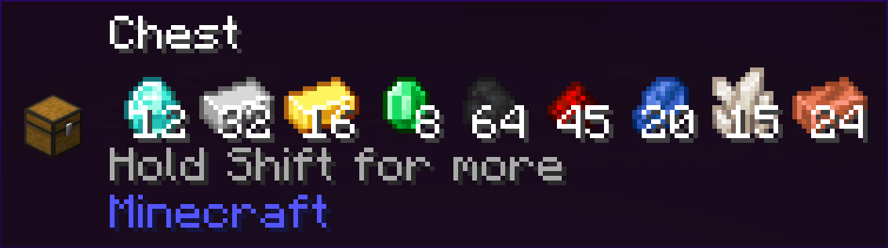
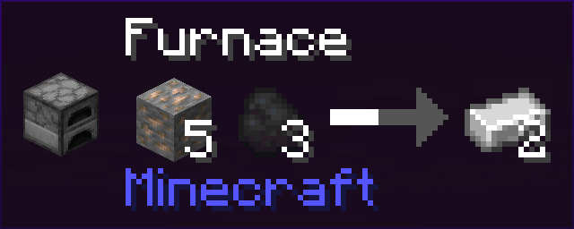
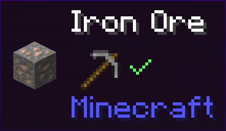
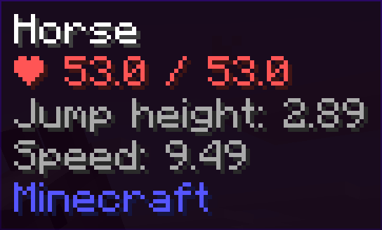

# Jade for Horizon

**English** | [简体中文](README.md)

[](https://github.com/rt-game-440/jade-horizon/releases)
[](LICENSE.md)


An unofficial WebAssembly port of [Jade](https://github.com/Snownee/Jade) (by Snownee) to [Horizon](https://playhorizon.dev), the Rust rewrite of Minecraft 26.3.
Point your crosshair at a block or an entity and its information is shown at the top of the screen.

This project is not an official work of Snownee and is not endorsed by the original author.

| Container (server-side too) | Furnace progress | Harvest info | Mob |
| --- | --- | --- | --- |
|  |  |  |  |

## Compatibility

| Jade for Horizon | Horizon | SDK | mod API | Minecraft |
| --- | --- | --- | --- | --- |
| 0.1.0 | nightly-2026-11-19 | `5ef7734` | 0.2 | 26.3 |

Other Horizon versions are untested. See [CHANGELOG.md](CHANGELOG.md) (Chinese) for per-version changes.

## Installation

Download `jade.hmod` from [Releases](https://github.com/rt-game-440/jade-horizon/releases), put it in the `horizon-mods/` folder of your game directory,
and add the line `mod.jade:true` to `horizon-mods.txt`.

- Multiplayer: installing on the client gives you the basic features; install on the server too to see server-side data such as container contents and furnace progress.
  The manifest says `side = "client"`, so Horizon does not compare jade when joining a server and you can join with only one side installed (verified on a dedicated server).
  The trade-off: the game will not refuse a join when the two sides have different versions. A side with a mismatched protocol version treats the other side as "not installed" and shows client-only information.
- Singleplayer: client installation is enough. Whether the integrated server also loads a `side = "client"` package (which decides whether container contents are visible) has not been tested yet.

## Features

Client only:

- Name, icon and owning mod (ObjectName / ModName)
- Mob health (heart icons; a number when max health exceeds 20)
- Crop growth, repeater delay, comparator mode, lever state, redstone power, note block instrument and pitch, beehive honey level, unstable TNT
- Harvest info: which tool the block needs and whether your held tool can collect its drops
- Fluids: pointing at water, lava, etc. shows the name and a bucket icon (enabled by default, as in Jade)
- Hold Shift for details: container contents are one line by default, and long-tail info such as breeding cooldown and growth time moves to the detailed view

Additionally shown when the server has it installed:

- Container contents (read through the `horizon:storage` capability, for vanilla containers and modded ones that register it), loot not yet generated, container locked
- Energy buffers and fluid tanks (read through `horizon:energy` and `horizon:fluids`, drawn as coloured bars with values; cauldrons too)
- Furnace / blast furnace / smoker progress, brewing stand progress and fuel, campfire cooking progress
- Beehive bee count, spawner mob and cooldown, jukebox disc, lectern book, item frame item
- Baby mob growth time, breeding cooldown, love state, next egg time for chickens

The server only answers for targets within 16 blocks in the same dimension. Both network packets are registered as optional (`optional()`) and carry a protocol version;
if the other side is missing or the version differs it is treated as not installed, and only client-known information is shown.

## Settings and key bindings

In game: "Options > Mods > Jade":

- Master switch, anchor (top centre / top left / top right / middle left / middle right), horizontal and vertical offset, background opacity
- Theme: Classic (Vanilla-like), Dark, Light, High contrast (text/background contrast of at least 4.5:1)
- Animation: fade when the target changes, smooth size transitions
- Per-item toggles: health, armor, potions, horse stats, villagers, owner, container contents, furnace progress, crops, redstone, harvest tool and progress, fluids, drops, mod name
- Debug stats: when on, network counters are written to `horizon-mod-data/jade/perf.json` every 10 seconds (used by `tools/perf.py`; off by default)

Two key bindings are under "Controls": `Show Overlay` (default Numpad 1, runtime toggle, resets on restart) and `Toggle Fluid` (default Numpad 2).
While the tooltip is hidden nothing is assembled and no requests are sent. Scaling is not implemented: Horizon's `DrawContext` has no scaling and item icons cannot be drawn with a transform.

## Building

```bash
cargo horizon-mod build --wasm
```

The output is `target/horizon-mod/jade.hmod`.

## Checks

```bash
cargo test
cargo horizon-mod check
```

`cargo test` includes a translation key check: every Jade translation key used in code must exist in both `en_us.json` and `zh_cn.json`.
`tools/api.py <regex>` searches API signatures in the SDK's `surface.json`.

## In-game acceptance, multiplayer e2e and performance baseline

These tools drive a real Horizon client and server (screenshot diffing against `tests/baselines/`, two-client e2e, CPU/request-rate baseline).
They require an installed Horizon launcher. Usage is documented in detail in the [Chinese README](README.md#游戏内验收); the entry points are:

```powershell
python -I tools/accept.py      # pixel-compare all scenarios (--update to rewrite baselines, --only <name> to filter)
python -I tools/e2e_mp.py      # two-client multiplayer end-to-end
python -I tools/perf.py        # performance baseline comparison
python -I tools/ui_check.py    # screenshots of the settings page and animation for visual review
```

## Releasing

1. Bump `version` in `horizon-mod.toml`, move the "Unreleased" entries in `CHANGELOG.md` under `## <version>`, and update the compatibility table above.
2. After merging to main, tag and push: `git tag v<version>` then `git push origin v<version>`.
3. When CI passes it checks the tag against `version` and publishes `jade.hmod` to a GitHub Release, using the matching CHANGELOG section as the notes.

## License and credits

- Original work: Jade © Snownee, [CC BY-NC-SA 4.0](https://creativecommons.org/licenses/by-nc-sa/4.0/).
- This port rewrites part of Jade's functionality in Rust on the Horizon mod API; layout and displayed content follow the original.
  The language files under `assets/jade/lang/` are taken directly from Jade (branch 26.3-neoforge); translations belong to Jade and its translators.
- This project is also released under CC BY-NC-SA 4.0 (see `LICENSE.md`) and must not be used commercially.
- Approved by the original author: on 2026-11-21 we asked in [Snownee/Jade#847](https://github.com/Snownee/Jade/issues/847) about public release, keeping the name and the attribution wording,
  and Snownee replied (in Chinese) "Sure. I hope you keep it updated." This remains an unofficial port, and we will comply with any change the original author requests.
